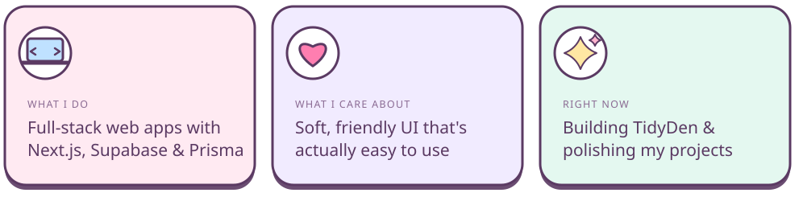
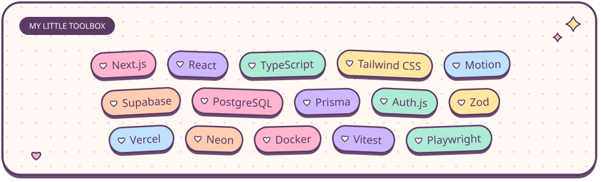

 

### 🎀 &nbsp;Things I've made

  
  

  
  

### 🐛 &nbsp;A hungry little caterpillar eats my commits

<picture>
  <source media="(prefers-color-scheme: dark)" srcset="https://raw.githubusercontent.com/Ali2424-meh/ali2424-meh/output/snake-dark.svg" />
  
</picture>

made with lots of pastel and a little bit of code ♡

